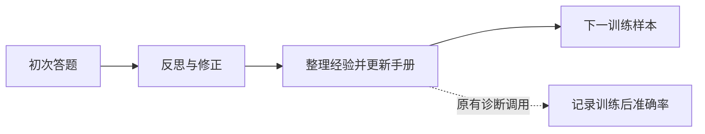

# 保留完整离线学习路径的执行优化：移除测量专用答题

## 改动及源码依据

上游 `ACE._train_single_sample` 在生成、反思和整理经验之后，还会执行一次 `_post_curate` 答题。
该响应仅用于记录训练后准确率，不更新手册、条目计数或下一步学习输入；选定手册依据另一次验证集评估。

本原型仅跳过这个诊断请求，保留所有正确题反思、错误题修正和 Curator 更新。
它与“首次答对就跳过反思和整理”的第一轮选择性反思不同，不删除学习机会。
本结论只针对本项目的离线训练；若在线模式把更新后答题作为真正任务输出，则不能直接移除该调用。

跳过诊断后训练后准确率标为“未测量”，不填零，也不复制初次答题准确率。
代码提供 `learning_step` 原型与独立驱动，不能把其空缺诊断值直接喂入原始 `_offline_train` 的准确率统计。
上游源码与旧实验保持原样，没有覆盖已经完成的训练或重新收费。

## 零 API 的真实归档回放验证

对种子 42、43、44 分别重放原始完整流程与优化流程；每个保留请求必须与原归档的模型、提示词、角色、
call ID、输出上限和参数指纹一致，任何偏离即停止，不允许回放程序发起新请求。

| 核验项 | 结果 |
|---|---|
| 三种顺序的 60 个训练步状态 | 全部一致，合计 180 步 |
| 条目全局 ID 与初次答案 | 每步一致 |
| 第 30、60 步的验证结果 | 全部一致 |
| 三份最终选定手册 | SHA-256 与真实原始冻结手册一致 |
| 原始保留训练＋验证请求回放 | 962 次 |
| 去掉诊断后的训练＋验证请求回放 | 782 次 |
| 此次新 API 调用 | 0 |

## 能确认的收益与边界

只看学习调用，原始 782 次降至 602 次，减少 **23.02%**。验证调用没有省略。
按历史实际 tokens 和统一无缓存价格归因，学习成本从 **8.768 元降至 6.767 元，减少 22.83%**。
这些是三次训练合计的历史轨迹归因，不是本次已重新训练后核对的实付节省，也不会返还旧调用费用。

这个证据支持“在相同保留响应下，优化不改变学习状态或选定手册”，不是准确率提高。
使用同一手册和原始答题提示时，推理输入也不改变；新的在线模型响应仍可能有随机差异。
移除诊断可能改变后续请求的缓存预热，因此**不能直接把历史含缓存费用相减当成实际费用收益**。

这属于移除测量开销的工程/执行优化，不能单独包装成新的 ACE 学习算法。
若追求更强的准确率保护，它比删除反思机会或删减经验更值得先采用；若追求推理费用和延迟，
第二轮短输出实验提供了另外一组明确但仍有精度权衡的证据。

运行：`.venv/bin/python -m repro.diagnostic_free_replay`。依赖本地忽略目录中的原始响应归档；
不下载模型、不创建 API client，也不读取新的测试标签。明细见 `diagnostic_free_replay.json`。
